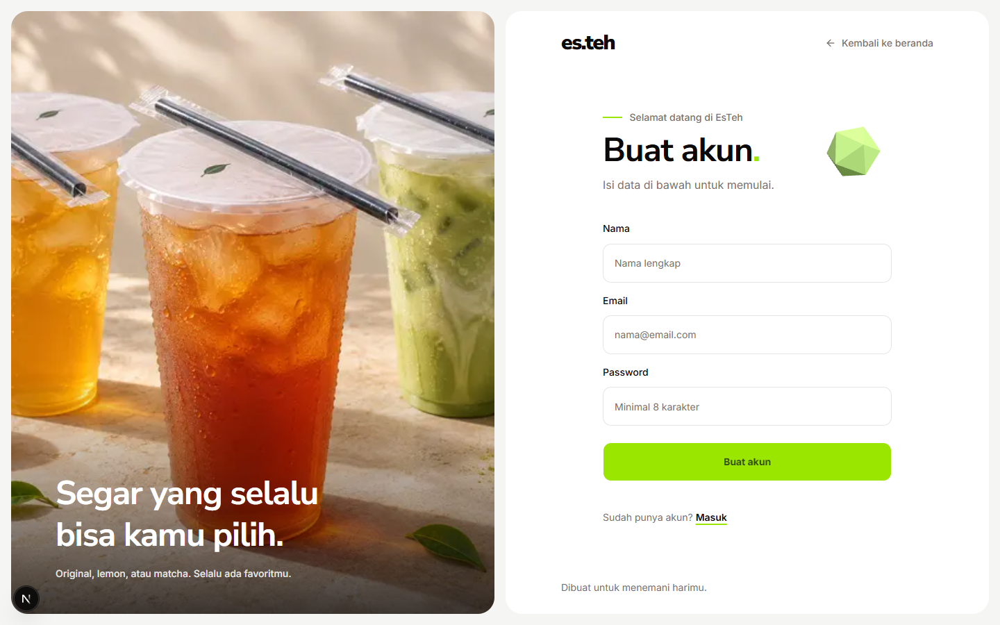
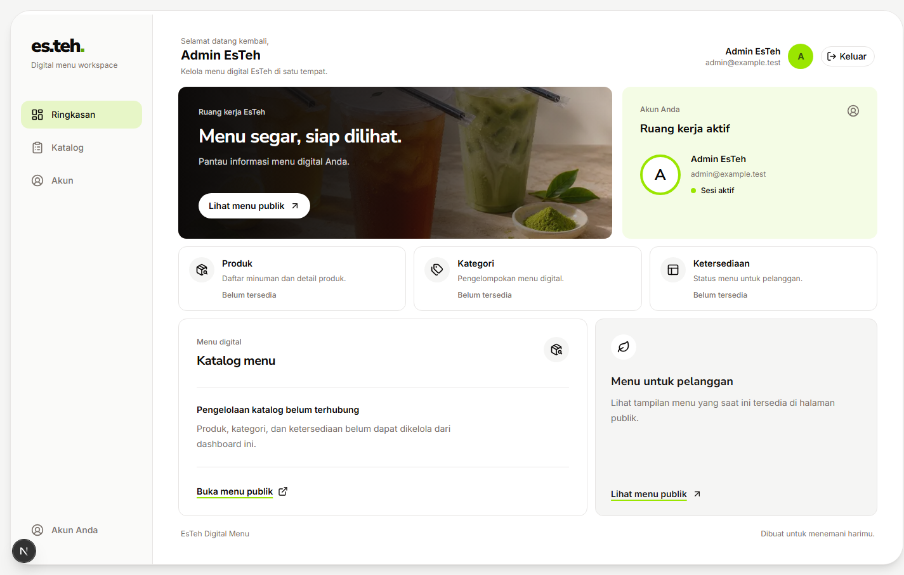

# Next.js template

This is a Next.js template with shadcn/ui.

## Panduan visual

Contoh tampilan berikut menunjukkan alur registrasi dan dashboard. Gambar
merupakan dokumentasi desain sebelumnya; beberapa detail dapat berbeda dari
versi aplikasi terkini.

### Registrasi



Buat akun melalui halaman registrasi, lalu masuk untuk membuka dashboard.

### Dashboard



Gunakan dashboard untuk melihat katalog dan status pesanan. Pengelolaan produk
dan pengaturan toko hanya tersedia untuk admin.

## Adding components

To add components to your app, run the following command:

```bash
npx shadcn@latest add button
```

This will place the ui components in the `components` directory.

## Using components

To use the components in your app, import them as follows:

```tsx
import { Button } from "@/components/ui/button";
```

## Menjalankan dengan Docker

### Persyaratan

- Git dan Docker Desktop dengan Docker Compose.
- Docker Desktop sudah berjalan dan port **3001** tersedia.

### Instalasi

1. Clone repository dan masuk ke direktori proyek:

   ```bash
   git clone https://github.com/zagoourai-hub/menu-digital.git
   cd menu-digital
   ```

2. Buat file `.env.docker` di root proyek:

   ```env
   AUTH_SECRET=isi-secret-acak-yang-panjang-dan-unik
   AUTH_URL=http://localhost:3001
   ```

   Buat secret misalnya dengan `openssl rand -base64 32`. Jangan bagikan atau
   commit `.env.docker`.

3. Build dan jalankan aplikasi:

   ```bash
   docker compose up --build -d
   ```

   Buka <http://localhost:3001>. Migrasi database dijalankan otomatis saat
   container dimulai. Untuk melihat log atau menghentikan container:

   ```bash
   docker compose logs -f app
   docker compose down
   ```

Database SQLite dan gambar upload disimpan dalam volume Docker, terpisah dari
database lokal. Database baru masih kosong, termasuk akun admin dan menu.
**Jangan gunakan `docker compose down -v`** kecuali ingin menghapus data volume.

Panduan membuat admin, mengisi menu seed, dan mengganti port tersedia di
[`docs/docker.md`](docs/docker.md). Container menggunakan mode production:
checkout Midtrans sandbox dinonaktifkan dan pembayaran nyata belum tersedia.
Supabase belum dikonfigurasi.
